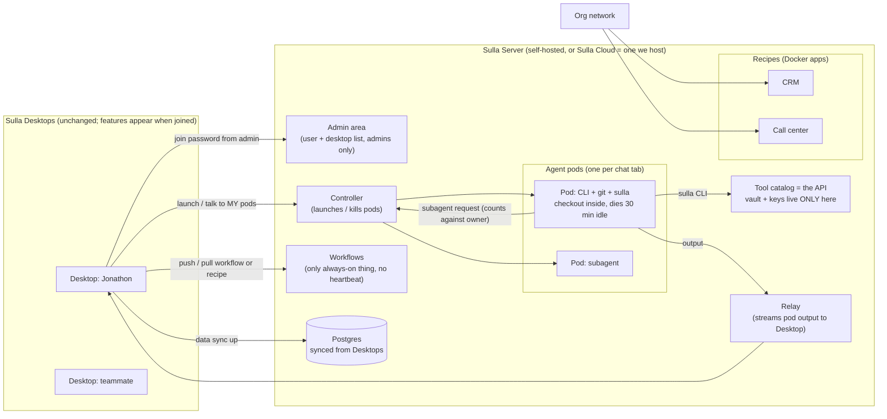
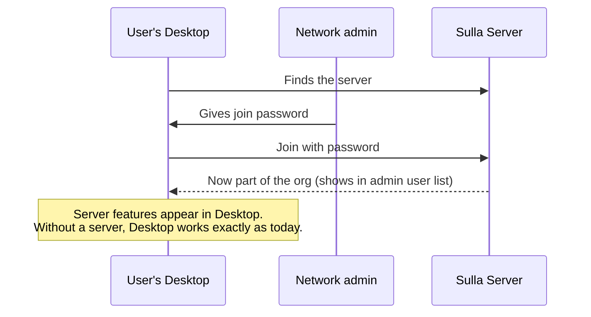
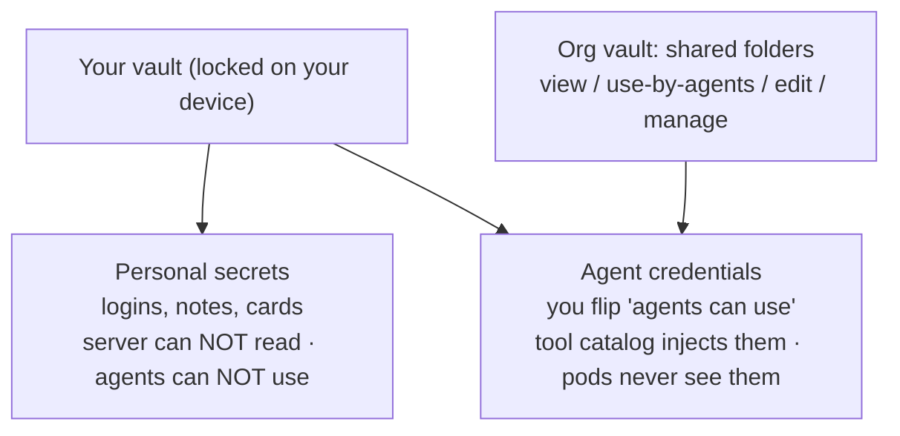

# Sulla Server: what we decided (2026-10-15)

## 1. The big picture

## 2. Joining a server

## 3. Vault (our own, Bitwarden-style)

- An agent pod acts as the person who launched it, never with more access than they have.
- Every time an agent uses a credential, it's logged.

## 4. Decided in one list
- Product line: Sulla Server first → Sulla Enterprise later, built on top.
- No billing anywhere on the server.
- Recipes run on the server and the org network can reach them; org-wide ones are an admin decision.
- Workflows and recipes move Desktop ⇄ server.
- Git checkout lives inside the pod; only pushed work survives.
- No heartbeat on the server; scheduled work = workflows.
- Each user can run their own Claude/Codex subscription on the server; orgs can add shared API keys.
- Memory is personal by default, shared on purpose.
- Per-user browser profiles and GitHub connections on the server.
- Pods get internet by default; internal network access is an admin setting.
- Upgrades back up first; nightly backups.
- Workbench is being removed from Desktop.
