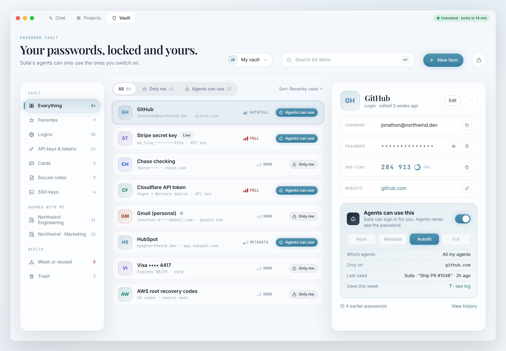
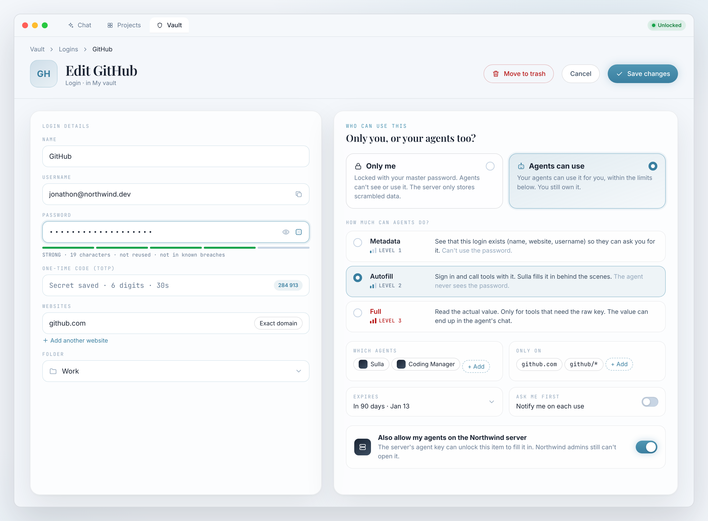
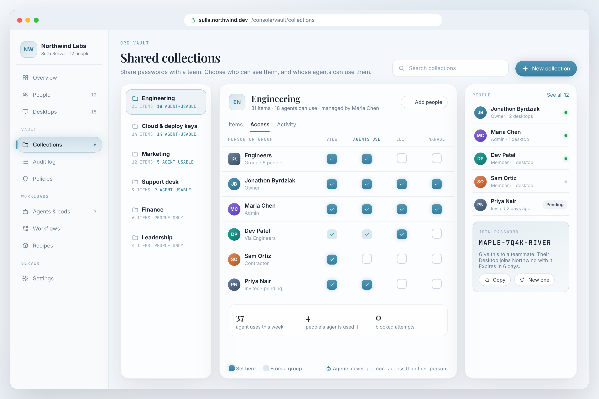
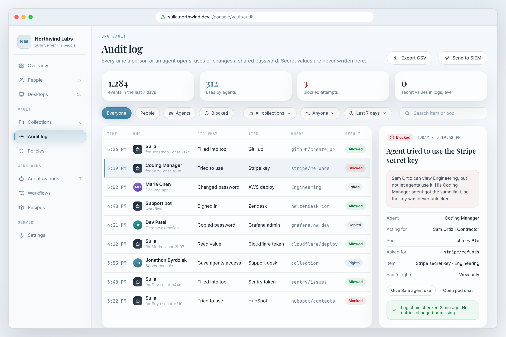
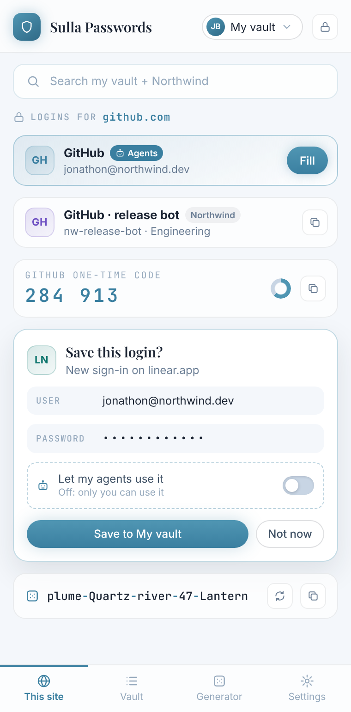

# Sulla Vault: UI mockups (for approval)

Static design mockups, nothing built yet. One vault UI shows up in three places: Sulla Desktop, the server's web console, and the Sulla Passwords Chrome extension. Theme: Noir Light. All names, sites and codes are fake.

Each screen has its HTML source next to the PNG (`*.html` + `vault.css`).

### 1. Desktop: vault list + item detail
Every item shows who can use it: **Only me** (grey lock) or **Agents can use** (blue), plus its AI access level.

### 2. Desktop: edit an item and choose agent access
Pick "Only me" or "Agents can use", then how much agents can do (Metadata / Autofill / Full) and the limits.

### 3. Server console: shared collections, people and rights
Per-collection rights: View / Agents use / Edit / Manage, for people and groups. Join password for new Desktops.

### 4. Server console: audit log
Every person and agent use, with the reason when an agent is blocked. No secret values are ever logged.

### 5. Chrome extension popup (Sulla Passwords)
Logins for the current site, one-time code, save-new-login (agents off by default), password generator, search.

